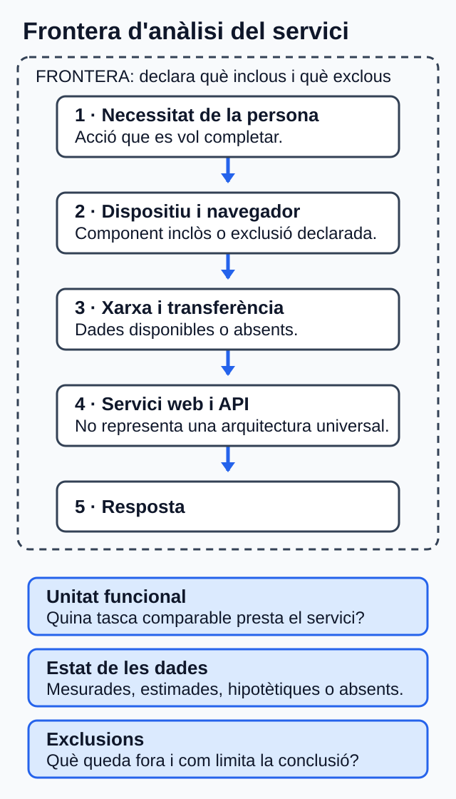
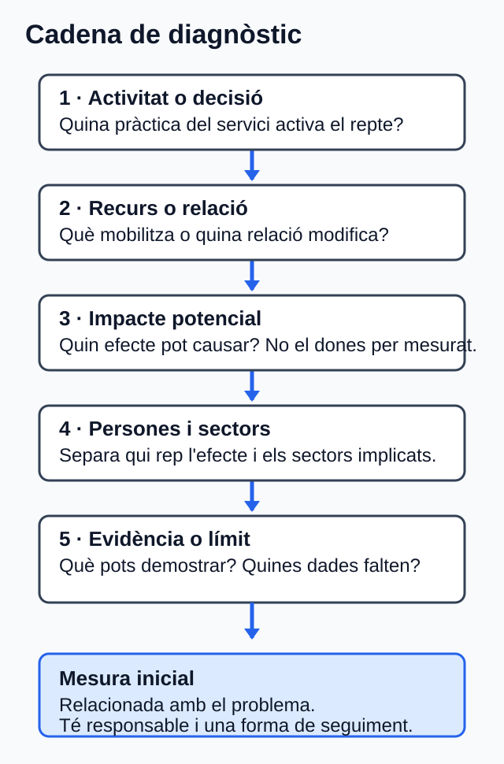

# Reptes ambientals i socials del sector digital

## Orientació

### Què aprendràs

Aprendràs a mirar un servici web amb criteri, no amb intuïcions. A partir d'un
cas senzill, delimitaràs què analitzes, detectaràs reptes i els convertiràs en
propostes pràctiques. L'objectiu és que el diagnòstic siga útil, no sols
correcte en teoria.

El producte final serà un **diagnòstic argumentat d'un servici web**. Hauràs de
distingir què saps, què no saps i què no pots afirmar encara.

### Itinerari i temps estimat

| Tram | Què faràs | Temps |
| --- | --- | ---: |
| Obertura | Entendràs el producte final i el recorregut | 10 min |
| Mapa de reptes | Situaràs els reptes ambientals i socials generals | 40 min |
| Bloc 1 | Delimitaràs el servici i la qualitat de les dades | 35 min |
| Cas guiat | Veuràs com arranca un diagnòstic realista | 25 min |
| Blocs 2 i 3 | Relacionaràs impactes, mesures i coordinació | 65 min |
| Activitat central | Elaboraràs el teu diagnòstic | 100 min |
| Autoavaluació | Comprovaràs si has entés el nucli de la unitat | 50 min |
| Tutoria o treball equivalent | Resoldràs dubtes o consolidaràs el diagnòstic | 30 min |
| Tancament | Revisaràs les fonts i el resum | 5 min |
| **Total** | **Estudi, activitat, autoavaluació, tutoria o treball equivalent i revisió** | **360 min (6 h)** |

Les referències de suport apareixen al final del document.

## 0. Mapa de reptes ambientals i socials

La sostenibilitat no es limita a un problema ambiental aïllat. Els reptes es
relacionen entre si: una decisió sobre energia, materials, mobilitat o disseny
pot afectar ecosistemes, condicions de vida, oportunitats d'accés i activitat
econòmica. Este mapa procedix de la presentació docent de la unitat [PRE-01].

### 0.1. Reptes ambientals

| Repte | Idea per a entendre'l | Connexió inicial amb un servici digital |
| --- | --- | --- |
| Canvi climàtic | Alteració sostinguda dels patrons climàtics; l'activitat humana n'és la causa principal de l'escalfament global observat [PRE-01; TEC-14]. | Energia, infraestructura, xarxa, desplaçaments i decisions de compra poden formar part de la frontera d'anàlisi. |
| Contaminació | Introducció d'agents químics, físics o biològics que afecten l'aire, l'aigua, el sòl o les persones; també pot ser acústica o lumínica [PRE-01]. | No s'ha d'atribuir una contaminació concreta a una web sense dades del proveïdor, la infraestructura i la frontera. |
| Pèrdua de biodiversitat | La pèrdua d'hàbitats, la contaminació, el canvi climàtic, la sobreexplotació i les espècies invasores poden degradar ecosistemes [PRE-01]. | El servici depén d'equips, materials, energia i proveïdors; cal evitar afirmar un efecte directe sense evidència del cas. |
| Deforestació i erosió del sòl | La transformació del territori, l'extracció de recursos, la urbanització i els incendis poden reduir la capacitat del sòl per a retindre aigua i nutrients [PRE-01]. | És un impacte possible aigües amunt en les cadenes de subministrament, no una conseqüència demostrada de qualsevol aplicació. |
| Sobreexplotació de recursos i escassetat d'aigua | Hi ha sobreexplotació quan l'extracció o l'ús supera la capacitat de regeneració; l'aigua disponible és un recurs limitat [PRE-01]. | La infraestructura digital pot mobilitzar electricitat i aigua, però la dada global o d'un centre no es pot assignar automàticament al servici [TEC-01; NOR-03]. |
| Generació i gestió de residus | El model de comprar, usar i tirar incrementa els residus; cal prioritzar reducció, reutilització i reciclatge [PRE-01]. | Els equips informàtics exigixen decisions de manteniment, reutilització i entrega separada quan passen a ser residus d'aparells elèctrics i electrònics (RAEE) [TEC-04–TEC-05; NOR-04]. |

### 0.2. Reptes socials

La dimensió social incorpora les condicions en què les persones poden accedir a
recursos, drets, oportunitats i servicis. La presentació posa el focus en tres
reptes que també ajuden a formular preguntes per a un servici web [PRE-01].

| Repte | Què cal observar | Pregunta aplicable a DAW |
| --- | --- | --- |
| Pobresa | La falta de recursos per a satisfer necessitats bàsiques pot reforçar l'exclusió en educació, salut, habitatge o participació [PRE-01]. | El cost de connexió, les dades mòbils o un procés excessivament pesat poden dificultar l'accés? |
| Desigualtats | Són diferències injustes en l'accés, la distribució o el gaudi de recursos, oportunitats i drets; poden ser econòmiques, de gènere, ètniques, territorials, d'edat o vinculades a la discapacitat [PRE-01]. | El flux es pot completar amb teclat, lector de pantalla, connexions lentes i dispositius diversos? |
| Repte demogràfic | Inclou despoblació, envelliment i població flotant; pot afectar la disponibilitat de servicis, connectivitat i oportunitats en els territoris [PRE-01]. | El servici pressuposa cobertura, competències digitals o atenció presencial que no estan disponibles per a totes les persones? |

!!! note "No convertisques el mapa en un diagnòstic"
    Este apartat identifica mecanismes generals. Per a afirmar que un servici
    concret provoca o resol un impacte, cal delimitar-lo, aportar evidència i
    declarar les dades absents.

### 0.3. Activitat econòmica, sectors i respostes

Els reptes afecten el sector primari, el secundari i el terciari: alteren la
disponibilitat de recursos, les cadenes de subministrament, les infraestructures,
els costos, les condicions de treball i l'accés als servicis [PRE-01]. En un
servici web, la relació no és només ambiental: també pot afectar la inclusió,
la privacitat, l'ocupació i la confiança de les persones usuàries.

Les respostes generals que recull la presentació són la transició i l'eficiència
energètiques, la mobilitat sostenible, la conservació de la biodiversitat, el
consum i la producció circulars, les polítiques públiques, l'educació ambiental i
les aliances [PRE-01]. En esta unitat no has de dissenyar una política completa:
has de traduir una d'estes línies en una mesura concreta, amb responsable,
seguiment i límits.

## 1. Delimita el servici abans d'opinar

Si no delimites què estàs analitzant, acabaràs barrejant intuïcions amb dades.

Un **servici web** no és només el codi. També pot implicar navegador, xarxa,
API, base de dades, infraestructura, proveïdors i equips [TEC-03; TEC-16].

Una **frontera** indica què inclous i què exclous.

Una **unitat funcional** és la unitat amb què compararàs el servici: per exemple,
una compra completada, una reserva o una petició resolta.

> **Idea clau**
>
> Primer delimita. Després interpreta. Si canvies la frontera o la unitat
> funcional a mitjan anàlisi, la conclusió deixa de ser fiable.

**Lectura visual ràpida de la cadena del servici**

`necessitat de la persona -> dispositiu -> xarxa -> servici web i API -> infraestructura i proveïdors -> resposta`

L'esquema orienta, però no fixa una arquitectura universal.

<div class="recurs-visual" markdown="1">



*Figura. Mapa per declarar què s'inclou i què s'exclou en l'anàlisi d'un servici web; la cadena i els passos adjacents en són l'alternativa textual. Il·lustració original, equip de disseny del projecte, CC0 1.0.*

</div>

> **Pas a pas**
>
> 1. Escriu quina acció vols observar.
> 2. Tria una unitat funcional clara.
> 3. Anota què entra dins de la frontera.
> 4. Anota què queda fora.
> 5. Marca quines dades són reals, estimades, hipotètiques o no disponibles.

| Etiqueta de dada | Què vol dir | Què has de fer |
| --- | --- | --- |
| Mesurada | Prové d'observació o de telemetria (registres automàtics del funcionament) | Indica instrument, període i cobertura |
| Estimada | Depén de supòsits o factors | Explica d'on ix l'estimació |
| Hipotètica | És pròpia del cas didàctic | No la presentes com a dada real |
| No disponible | No tens la font necessària | No inventes el valor |

Esta classificació conserva la diferència entre mesura, estimació i dada absent;
qualsevol quantificació ha de declarar frontera, unitat funcional i mètode
[TEC-03].

> **Error habitual**
>
> No convertisques trànsit, pes de pàgina o nombre de peticions en emissions
> demostrades si no tens el model o la telemetria necessaris [TEC-02–TEC-03].

### Microparada

**Pregunta de control.** Si compares dos versions d'un servici, estàs usant la
mateixa unitat funcional en les dos?

## Cas guiat DAW: Mercat Obert

### Mini història

Una persona entra a Mercat Obert per fer una compra ràpida. La portada descarrega
imatges originals, el recorregut de compra té barreres de teclat i el formulari
demana més dades de les necessàries. Quan l'equip revisa el cas, veu que no té
dades aplicables sobre electricitat, aigua o emissions del servici.

> **Clau del cas**
>
> Totes les dades són hipotètiques. Servixen per a aprendre a raonar, no per a
> descriure el centre ni una empresa real. Ací no cal calcular CO2e (diòxid de carboni equivalent) ni omplir
> buits amb xifres inventades.

### Què has d'observar

- Pes del catàleg.
- Accessibilitat del recorregut de compra.
- Recollida de dades sense justificació clara.
- Absència de dades ambientals aplicables.

> **Exemple**
>
> Este cas és útil perquè combina tres errors molt habituals alhora: massa pes,
> barreres d'accés i recollida de dades sense justificació clara.

### Arrancada del diagnòstic

Per a començar, el cas ja fixa algunes decisions importants. La idea és que no
hages de decidir-ho tot des del principi: només has de donar unes bases clares
per a analitzar els reptes.

| Element | Decisió inicial | Per què és útil |
| --- | --- | --- |
| Unitat funcional | Una compra completada | Permet comparar el mateix procés en cada anàlisi |
| Frontera | Navegador, xarxa, CDN (xarxa de distribució de continguts), aplicació, API i base de dades | Definix què s'inclou en l'estudi i què no |
| Exclusions | Fabricació del dispositiu de la clientela i qualsevol dada ambiental no disponible | Evita confondre dades desconegudes amb dades reals |
| Límits | No es calcula CO2e i no s'inventen valors absents | Manté la prudència i el rigor del diagnòstic |

### Cadenes d'impacte del cas

| Repte | Què passa en l'activitat | Persones afectades | Sectors afectats | Mesura inicial |
| --- | --- | --- | --- | --- |
| Transferència i recursos | El catàleg mobilitza més dades de les necessàries en cada compra | Clientela amb connexions limitades | TIC, telecomunicacions i infraestructura de núvol | Adaptar formats, dimensions i compressió |
| Accessibilitat i bretxa | El procés de compra posa barreres a la navegació per teclat i pot penalitzar connexions lentes | Persones amb discapacitat o amb accés limitat | Comerç electrònic i servicis digitals d'atenció a clientela | Corregir barreres i revisar pes sense perdre accessibilitat |
| Privacitat | Es demanen dades sense una finalitat ja justificada | Persones compradores | Comerç electrònic, seguretat i gestió de dades | Eliminar camps no necessaris i justificar cada dada |
| Equips i RAEE | No hi ha registre de manteniment ni de final de vida dels equips | Persones que usen o gestionen els equips | TIC, fabricació d'equips i gestió de residus | Registrar manteniment, reutilització i entrega separada |

> **Idea clau**
>
> El diagnòstic no acaba en "hi ha un problema". Ha d'arribar, com a mínim, fins
> a una primera mesura viable.

### Context DAW ambiental i social: mapa diagnòstic

Un servici web participa en una activitat econòmica que mobilitza computació,
emmagatzematge, xarxa, equips i proveïdors. Les dades globals ajuden a reconéixer
mecanismes i reptes, però no descriuen Mercat Obert, Cita Clara, el centre ni la
seua clientela [TEC-01–TEC-09].

| Repte que cal considerar | Relació amb l'activitat DAW | Persones o sectors sobre els quals cal investigar l'efecte | Límit de l'evidència |
| --- | --- | --- | --- |
| Electricitat i aigua de centres de dades | L'allotjament i el núvol mobilitzen infraestructura; la demanda i les dades depenen del centre, la càrrega i l'assignació. | Comunitats i sectors energètic, hídric, TIC i de centres de dades. | Una dada mundial o d'un centre no s'atribuïx al servici analitzat [TEC-01; NOR-03]. |
| Transferència de xarxa | Cada flux web genera trànsit, però els bytes no són energia ni emissions. | Persones amb connexions limitades; telecomunicacions, TIC i comerç digital. | Cal frontera, unitat funcional i model abans de quantificar impactes [TEC-02–TEC-03]. |
| Equips i residus electrònics | La compra, l'ús, el manteniment i el rebuig connecten DAW amb materials i final de vida. | Persones treballadores i comunitats exposades; fabricació, reparació i gestió de residus. | Les dades globals no acrediten l'estat d'un equip; la gestió depén de l'àmbit aplicable [TEC-04–TEC-05; NOR-04]. |
| Bretxa digital i accessibilitat | El cost, la connexió, el dispositiu i les barreres de la interfície poden dificultar l'accés o una tasca. | Persones amb discapacitat o amb accés, renda o capacitats desiguals; servicis públics, comerç i atenció digital. | Les diferències globals no es poden inferir per a les persones del cas [TEC-06–TEC-10; NOR-02]. |
| Privacitat | Formularis, analítica i registres poden tractar dades personals. | Persones afectades; sectors de dades, seguretat i servicis digitals. | Cal conéixer finalitat, dades i abast; el RGPD s'aplica si el tractament entra en el seu àmbit [TEC-11; NOR-01]. |
| Ocupació i cadena de subministrament | El desenrotllament, les plataformes, el núvol i els equips impliquen treball i proveïdors. | Plantilles, persones col·laboradores i treballadores de proveïdors; TIC, plataformes i fabricació. | L'evidència sobre plataformes o minerals no descriu tota empresa DAW ni un proveïdor concret [TEC-12–TEC-13]. |

**Evidència observable RA2.a–RA2.c.** Abans del diagnòstic central, completa
sis files breus —tres reptes ambientals i tres socials— amb: (a) el repte
identificat; (b) la decisió o activitat econòmica DAW que el mobilitza; i (c)
les persones i els sectors potencialment afectats, més la dada que falta. Usa
estes sis files com a esborrany de la secció 2 de l'activitat central. Esta
evidència és diagnòstica: no demana encara el redisseny detallat d'U04.

## 2. Relaciona reptes, activitat i efectes

Ara ja no toca fer llistes soltes. Toca unir cada repte amb una activitat del
servici i amb els seus efectes.

La cadena mínima és esta:

`activitat o decisió -> recurs o relació -> impacte potencial -> persones i sectors -> límit o evidència`

<div class="recurs-visual" markdown="1">



*Figura. Bastida per connectar un repte ambiental o social amb afectacions, evidència i una mesura inicial. Il·lustració original, equip de disseny del projecte, CC0 1.0.*

</div>

> **Pas a pas**
>
> Per a cada repte, completa sempre la mateixa seqüència:
>
> 1. Quina decisió o activitat del servici l'activa?
> 2. Quin recurs mobilitza?
> 3. Quin efecte pot causar?
> 4. Qui el rep?
> 5. Què pots demostrar i què no?

| Si estàs mirant... | Pregunta't... |
| --- | --- |
| Electricitat, xarxa o núvol | Tinc dades del cas o només una idea general? |
| Accessibilitat | La barrera està comprovada o només sospitada? |
| Bretxa digital | Estic parlant de persones concretes o d'un mecanisme general? |
| Privacitat | La dada és necessària per a la finalitat declarada? |
| Equips i residus | Sé com es mantenen, es reutilitzen o es retiren? |
| Ocupació o proveïdors | Tinc evidència del cas o estic generalitzant massa? |

> **Error habitual**
>
> Evita frases com "això afecta la societat" si no expliques a quines persones o
> a quins sectors afecta, i per quin mecanisme.

> **Exemple**
>
> "La portada descarrega imatges massa pesades -> augmenta la transferència ->
> pot dificultar l'ús amb connexions limitades -> afecta clientela amb menys
> amplària de banda i operacions de xarxa -> no puc quantificar l'efecte total
> sense dades del cas" [TEC-02–TEC-03; TEC-06–TEC-09].

### Microparada

**Pregunta de control.** En almenys un dels teus reptes, has separat clarament
les persones afectades dels sectors afectats?

## 3. Passa del diagnòstic a l'acció

Una mesura útil ha de tindre tres elements: relació amb el problema, responsable
i forma de seguiment [TEC-15–TEC-16].

| Impacte detectat | Mesura útil | Qui l'ha d'impulsar | Com la seguiràs |
| --- | --- | --- | --- |
| Massa transferència | Optimitzar mitjans i peticions | DAW + disseny + operacions | Comparació en la mateixa unitat funcional |
| Barreres d'accés | Corregir incidències comprovades | UX + DAW + persones usuàries en proves | Revisió dels criteris afectats [TEC-10; NOR-02] |
| Recollida excessiva de dades | Reduir camps i justificar finalitats | Producte + DAW + privacitat | Inventari de dades i revisió del formulari [TEC-11; NOR-01] |
| Vida útil dels equips | Mantindre, reutilitzar i retirar bé | TIC + compres | Registre de manteniment i final de vida [NOR-04] |

> **Idea clau**
>
> No busques una solució "perfecta". Busca una mesura defensable i comprovable.

### Coordinació mínima que sí és creïble

No basta dir "l'equip col·labora". Has de concretar qui fa què.

| Actor | Funció |
| --- | --- |
| Producte | Prioritza i decidix compensacions |
| UX | Detecta barreres i prova recorreguts |
| DAW | Implementa millores i registra canvis |
| Operacions | Aporta telemetria i límits d'infraestructura |
| Privacitat o legal | Revisa necessitat i tractament de dades |
| Compres o TIC | Gestiona equips, manteniment i retirada |

> **Pas a pas**
>
> Quan proposes una coordinació:
>
> 1. Nomena els actors.
> 2. Assigna una funció real a cada actor.
> 3. Digues quina informació aporta cada un.
> 4. Explica com revisaran el resultat.
> 5. Deixa visible qui decidix si hi ha compensacions.

> **Error habitual**
>
> No assumisques que una millora tècnica resol també accessibilitat, privacitat o
> sostenibilitat global. Cada decisió pot millorar una cosa i empitjorar-ne una altra.

### Microparada

**Pregunta de control.** La teua proposta diu qui decidix si hi ha conflicte
entre rendiment, accessibilitat, privacitat o cost?

## Activitat central: diagnòstic de Cita Clara

### Objectiu

Faràs un diagnòstic argumentat d'un servici de reserves web.

### Enunciat

**Les dades següents són hipotètiques.** Cita Clara permet reservar cites en
línia. La portada descarrega recursos multimèdia sense adaptar-los al dispositiu, repetix
consultes i demana més dades de les necessàries. No consta una revisió
documentada d'accessibilitat ni un protocol clar de manteniment o retirada
d'equips. Tampoc hi ha dades aplicables del proveïdor sobre electricitat, aigua
o emissions del servici.

> **Pas a pas**
>
> 1. Delimita la frontera, la unitat funcional i les dades disponibles (10 min).
> 2. Completa el mapa contextual de sis reptes: tres ambientals i tres socials
>    (25 min).
> 3. Selecciona quatre reptes del mapa que tinguen una observació directa en el
>    cas i una mesura inicial viable, i completa'n la cadena diagnòstica (30 min).
> 4. Proposa una mesura amb responsable i seguiment per a cada un (20 min).
> 5. Tanca amb una coordinació viable (10 min).
> 6. Revisa els límits, les citacions i el registre de dubtes (5 min). Si inclous
>    afirmacions generals que no procedixen de l'enunciat, cita les referències
>    d'esta unitat. No cal citar les dades hipotètiques del cas.

### Com realitzar el treball

**Pas 1.** Delimita què analitzes. Indica la **unitat funcional** i els
components que inclous en la frontera.

**Pas 2.** Identifica sis reptes: tres ambientals i tres socials. Per a cada un,
relaciona'l amb una activitat del servici, les persones i els sectors que podria
afectar, i la dada que falta.

**Pas 3.** Tria quatre reptes prioritaris que tinguen una observació directa en
el cas i una mesura inicial viable. Explica la cadena: activitat o decisió,
recurs o relació, impacte potencial, persones o sectors i límit de l'evidència.

**Pas 4.** Proposa una mesura per a cada repte prioritari. Ha d'indicar qui la
impulsa i com se'n comprovarà el resultat.

**Pas 5.** Explica com es coordinen els actors necessaris i quina informació
aporta cadascun.

**Pas 6.** Tanca el diagnòstic amb les conclusions i les dades que encara no
permeten fer afirmacions quantitatives.

### Plantilla de treball

Completa les sis seccions i presenta-les en un document de format obert
compatible amb Aules.

```text
# Diagnòstic de Cita Clara

## 1. Frontera, unitat funcional i qualitat de dades

## 2. Mapa contextual de sis reptes
| Repte ambiental o social | Activitat econòmica DAW | Persones | Sectors | Dada absent o límit |

## 3. Quatre reptes prioritaris
| Repte | Activitat o decisió | Recurs o relació | Impacte potencial | Persones afectades | Sectors afectats | Límit o evidència |

## 4. Mesures
| Repte | Mesura | Responsable | Seguiment |

## 5. Coordinació
| Actor | Funció | Informació que aporta | Decisió o seguiment |

## 6. Conclusions i registre de dubtes
```

### Possible solució comentada

Esta és una resposta model. No és l'única possible, però mostra la diferència
entre una observació del cas, un impacte potencial i una dada que no està
disponible.

#### 1. Frontera, unitat funcional i qualitat de les dades

- **Unitat funcional:** una reserva completada.
- **Frontera:** navegador, xarxa, recursos multimèdia de la portada, aplicació
  web, API i base de dades.
- **Dades del cas:** la càrrega de mitjans no s'adapta al dispositiu, es repetixen
  consultes, es demanen més dades de les necessàries i no consta una revisió
  documentada d'accessibilitat ni un protocol per als equips.
- **Dades absents:** electricitat, aigua, emissions, arquitectura concreta,
  regió d'allotjament i dades de proveïdors. Per això no es pot calcular CO2e ni
  atribuir consum d'aigua al servici.

#### 2. Mapa contextual de reptes

| Repte | Activitat o situació del cas | Persones i sectors | Dada absent o límit |
| --- | --- | --- | --- |
| Transferència i recursos | Mitjans sense adaptar i consultes repetides | Persones amb connexions limitades; telecomunicacions i TIC | No hi ha telemetria ni model per a quantificar energia o emissions. |
| Electricitat i aigua | Allotjament del servici | Comunitats, energia, aigua i centres de dades | No hi ha dades del proveïdor ni una assignació aplicable a Cita Clara. |
| Equips i RAEE | No consta un protocol de manteniment ni de retirada | Personal TIC, gestió de residus i comunitats exposades | No se sap quins equips hi ha ni el seu estat real. |
| Accessibilitat | No consta una revisió documentada | Persones amb discapacitat; comerç i atenció digital | L'absència de revisió no demostra per si sola una barrera concreta. |
| Bretxa digital | Mitjans pesats per a tots els dispositius | Persones amb connexions o dispositius limitats; xarxes i servicis digitals | No hi ha dades de les persones usuàries ni de les seues connexions. |
| Privacitat | Es demanen més dades de les necessàries | Persones que reserven; gestió de dades i seguretat | Cal conéixer la finalitat de cada camp per a valorar-ne la necessitat. |

#### 3. Quatre reptes prioritaris i mesures

| Repte | Cadena diagnòstica | Mesura, responsable i seguiment |
| --- | --- | --- |
| Transferència | Recursos multimèdia no adaptats i consultes repetides -> més trànsit -> ús més difícil amb connexions limitades -> no es quantifica l'impacte ambiental sense dades. | DAW i disseny adapten formats, dimensions i càrrega; operacions compara el pes i les peticions per reserva abans i després. |
| Accessibilitat | No consta revisió -> poden existir barreres -> possible exclusió de persones usuàries -> cal comprovar-les. | UX i DAW revisen els recorreguts amb criteris WCAG (pautes d'accessibilitat per al contingut web) i proves amb teclat; es registren i corregixen les incidències trobades. |
| Privacitat | Camps excessius -> tractament de dades que podrien no ser necessàries -> risc per a les persones afectades. | Producte, DAW i privacitat revisen finalitat i necessitat de cada camp; es manté un inventari de dades i es comprova el formulari. |
| Equips i RAEE | No consta protocol -> es pot perdre vida útil o gestionar malament el final de vida -> impacte potencial en materials i residus. | TIC i compres creen un registre de manteniment, reutilització i retirada separada; revisen periòdicament els equips retirats. |

#### 4. Coordinació i conclusió

| Actor | Funció en la solució |
| --- | --- |
| Producte | Prioritza les millores i resol les compensacions entre cost, rendiment, accessibilitat i privacitat. |
| UX i DAW | Detecten i corregeixen barreres; reduïxen recursos innecessaris sense eliminar informació imprescindible. |
| Operacions | Aporta les mètriques disponibles, els límits de la infraestructura i les dades que no es poden obtindre. |
| Privacitat | Revisa la finalitat, la necessitat i el tractament de les dades del formulari. |
| TIC i compres | Gestionen el manteniment, la reutilització i la retirada dels equips. |

**Conclusió comentada.** El cas permet prioritzar millores sobre rendiment,
accessibilitat, privacitat i gestió d'equips. En canvi, no permet afirmar quanta
energia, aigua o emissions estalviarà Cita Clara: eixes dades no apareixen en
l'enunciat i requeririen una frontera, telemetria o un model explícit.

## Autoavaluació

Respon sense mirar les solucions. Són sis preguntes i van al nucli de la unitat.

**Pregunta 1. Opció múltiple.** Quina unitat funcional és millor?

Opcions: a) «El núvol»; b) «Una reserva completada»; c) «La sostenibilitat del web».

**Pregunta 2. Vertader o fals.** Si una pàgina pesa menys, ja pots afirmar
quantes emissions has evitat.

**Pregunta 3. Resposta curta.** Quina diferència hi ha entre una dada estimada i
una dada no disponible?

**Pregunta 4. Opció múltiple.** Quina frase és més prudent?

Opcions: a) «Tot impacte digital afecta igual totes les persones»; b) «Cal
distingir persones afectades, sectors afectats i límits de la dada»; c) «Si no hi
ha telemetria, podem omplir el buit amb una xifra genèrica».

**Pregunta 5. Vertader o fals.** Una coordinació transversal es pot resumir en
«DAW ja ho arreglarà».

**Pregunta 6. Resposta curta.** Escriu una cadena simple que relacione activitat,
impacte potencial, persones afectades i una mesura.

## Solucionari raonat

**Resposta 1. b) «Una reserva completada».** És una acció concreta que es pot
comparar abans i després d'un canvi. «El núvol» i «la sostenibilitat del web» no
descriuen un servici prestat ni permeten establir una comparació equivalent.

**Resposta 2. Fals.** Una pàgina més lleugera pot reduir la transferència, però
els bytes no són una mesura directa d'energia ni d'emissions. Per afirmar un
estalvi d'emissions caldrien, com a mínim, una frontera, una unitat funcional,
telemetria o model i una metodologia declarada [TEC-02–TEC-03].

**Resposta 3.** Una dada estimada procedix d'un càlcul amb supòsits i fonts que
s'han d'explicar. Una dada no disponible és una dada que no tenim: no es pot
substituir per una xifra genèrica ni presentar-la com a real.

**Resposta 4. b).** És prudent perquè obliga a indicar qui rep l'efecte, en quin
sector es produïx i què es pot demostrar. Les opcions a) i c) generalitzen sense
evidència: els impactes no afecten igual totes les persones i la falta de
telemetria no autoritza a inventar valors.

**Resposta 5. Fals.** DAW pot implementar millores, però no pot decidir en solitari
la finalitat de les dades, les proves d'accessibilitat, la informació de la
infraestructura o el final de vida dels equips. Calen funcions, informació i
seguiment compartits [TEC-15–TEC-16].

**Resposta 6. Exemple.** «La portada carrega imatges sense adaptar al dispositiu
-> augmenta la transferència i pot dificultar l'ús amb connexions limitades ->
afecta persones amb menys amplària de banda -> DAW i disseny adapten les imatges i
comparen el pes per reserva». La frase no afirma emissions perquè el cas no aporta
les dades necessàries.

## Resum

- Primer delimita el servici.
- Els reptes ambientals i socials estan connectats, però el seu efecte concret
  s'ha de demostrar en cada cas.
- Després separa dades reals, estimades i absents.
- Relaciona cada repte amb una activitat concreta.
- Distingix persones afectades i sectors afectats.
- No inventes xifres per a omplir buits.
- Proposa mesures amb responsable i seguiment.
- Tanca amb una coordinació creïble.

## Referències

Les etiquetes conserven els identificadors del dossier documental d'U02. Totes
les fonts següents es van consultar el **30 de juliol de 2026**.

- **[PRE-01]** Presentació docent facilitada per al desenvolupament d'U02.
  *Retos ambientales y sociales*, 28 diapositives. Material de partida de la
  unitat, sense data editorial indicada; rebut el 14.10.2026.
- **[CUR-01]** Consell de la Generalitat Valenciana. *Decret 114/2025, de 29 de
  juliol*; DOGV-V-2025-29742, annex IX, pp. 118-119.
  <https://dogv.gva.es/datos/2025/08/04/pdf/2025_29742_va.pdf>
- **[NOR-01]** Parlament Europeu i Consell de la UE. *Reglament (UE) 2016/679
  (RGPD)*, articles 5, 24, 25 i 32.
  <https://www.boe.es/buscar/doc.php?id=DOUE-L-2016-80807>
- **[NOR-02]** Corts Generals. *Llei 11/2023, de 8 de maig*, títol I, articles
  1-4 i annex I. <https://www.boe.es/eli/es/l/2023/05/08/11/con>
- **[NOR-03]** Parlament Europeu i Consell de la UE. *Directiva (UE)
  2023/1791*, article 12.1-2 i annex VII.
  <https://www.boe.es/buscar/doc.php?id=DOUE-L-2023-81299>
- **[NOR-04]** Govern d'Espanya. *Reial decret 110/2015, de 20 de febrer, sobre
  residus d'aparells elèctrics i electrònics*, articles 12, 13 i 15.
  <https://www.boe.es/eli/es/rd/2015/02/20/110/con>
- **[TEC-01]** Agència Internacional de l'Energia. *Key Questions on Energy and
  AI*, 2026, resum executiu.
  <https://www.iea.org/reports/key-questions-on-energy-and-ai/executive-summary>
- **[TEC-02]** Unió Internacional de Telecomunicacions. *Facts and Figures
  2025*, «Internet traffic».
  <https://www.itu.int/itu-d/reports/statistics/2025/10/15/ff25-internet-traffic/>
- **[TEC-03]** Green Software Foundation. *Software Carbon Intensity (SCI)
  Specification*, versió 1.1.0, 2024, apartats metodològics citats.
  <https://sci.greensoftware.foundation/>
- **[TEC-04–TEC-05]** UNITAR i UIT. *Global E-waste Monitor 2024*; Organització
  Mundial de la Salut. *Electronic waste (e-waste)*, 2024.
  <https://www.unitar.org/about/news-stories/press/global-e-waste-monitor-2024-electronic-waste-rising-five-times-faster-documented-e-waste-recycling>
  <https://www.who.int/news-room/fact-sheets/detail/electronic-waste-(e-waste)>
- **[TEC-06–TEC-09]** Unió Internacional de Telecomunicacions. *Facts and
  Figures 2025*: ús d'Internet, bretxa de gènere, diferència urbana-rural i
  assequibilitat.
  <https://www.itu.int/itu-d/reports/statistics/2025/10/15/ff25-internet-use/>
  <https://www.itu.int/itu-d/reports/statistics/2025/10/15/ff25-the-gender-digital-divide/>
  <https://www.itu.int/itu-d/reports/statistics/2025/10/15/ff25-internet-use-in-urban-and-rural-areas/>
  <https://www.itu.int/itu-d/reports/statistics/2025/10/15/ff25-affordability-of-ict-services/>
- **[TEC-10]** World Wide Web Consortium. *Web Content Accessibility Guidelines
  (WCAG) 2.2*, Recomanació de 12.12.2024.
  <https://www.w3.org/TR/2024/REC-WCAG22-20241212/>
- **[TEC-11]** W3C Technical Architecture Group. *Privacy Principles*, W3C
  Statement de 15.05.2025. <https://www.w3.org/TR/privacy-principles/>
- **[TEC-12]** Organització Internacional del Treball. *World Employment and
  Social Outlook 2021: The role of digital labour platforms in transforming the
  world of work*. <https://www.ilo.org/publications/flagship-reports/role-digital-labour-platforms-transforming-world-work>
- **[TEC-13]** UIT-T. *Suplement L.Sup21*, aprovat el 27.04.2016, estat «In
  force». <https://www.itu.int/rec/T-REC-L.Sup21-201604-I/en>
- **[TEC-14–TEC-15]** IPCC. *Climate Change 2023: Synthesis Report. Summary for
  Policymakers*, apartats A.1-A.2.7 i C.1.2-C.7.6.
  <https://www.ipcc.ch/report/ar6/syr/summary-for-policymakers/>
- **[TEC-16–TEC-17]** W3C Sustainable Web Interest Group. *Web Sustainability
  Guidelines*, `Group Note Draft`, 29.07.2026; és un esborrany no avalat com a
  Recomanació W3C. <https://www.w3.org/TR/2026/DNOTE-web-sustainability-guidelines-20260729/>
